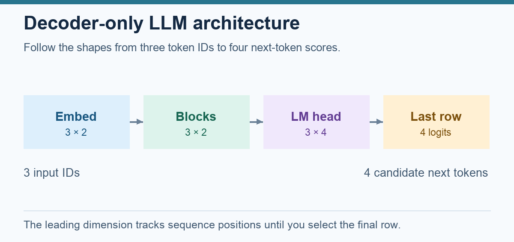
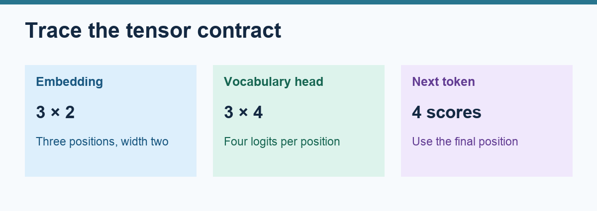

# Lab 1.3 · LLM architecture

**Time** 15–20 minutes · **Hardware** CPU · **Software** Python 3 and Jupyter

[Open notebook](lab.ipynb) · [Exercise plan](#lab-plan) · [Results to look for](#results-to-look-for)

## Concepts you will use

A decoder-only language model takes token IDs and produces next-token scores. An **embedding** is a lookup table with one vector per vocabulary entry. Each token gets its own row in the sequence, even when the same ID occurs twice. A position signal gives the model information about where each token appears. The toy position signal simply adds an index to a feature. Implementations such as rotary position embeddings instead inject position information inside attention.

The transformer stack updates those vectors while preserving the hidden width at its boundaries. A final projection, often called the **language model head**, gives each row one score per vocabulary entry. These raw scores are **logits**. During generation, the last row supplies the scores for the next token.

For two tokens, a hidden width of three, and a vocabulary size of five, the embedding output is `(2, 3)` and the head projection is `(2, 3) @ (3, 5) → (2, 5)`. Taking the final row leaves five candidate scores. The notebook uses deterministic row-wise placeholder blocks so you can focus on these interfaces. Real transformer blocks can mix information across positions through attention.

## Results to look for

1. Check that a repeated token can get a different position signal. Keep the lookup table unchanged so future lookups remain consistent.
2. If you add a position, another logits row appears. If you grow the vocabulary, the number of columns changes.

## Lab plan

| Exercise | What you will do | What to look for |
| --- | --- | --- |
| 1. Build the input vectors | Look up one vector per token ID and apply the supplied position convention to its first feature. | Check both the shape and the values. The embedding table should still contain its original vectors after the lookup. |
| 2. Project hidden states to logits | Complete the vocabulary projection, trace the shape after each block, and use the final logits row to choose a token. | When you append a token, the number of rows changes. The number of candidate scores per row stays tied to the vocabulary. |

Spend about 3–4 minutes on the worked example, 10–13 minutes on the exercises, and the last few minutes explaining the results.

## Reading a model configuration

Kiely uses the model configuration to connect architectural choices to runtime support. Hidden width and vocabulary size set the dimensions used in this lab. The number of blocks tells you how many times a hidden state passes through the block interface.

**Optional extension.** Change only the vocabulary size in the toy configuration. Predict which matrix shapes change, then vary the number of layers and compare again.

## Apply it to an inference system

**An incompatible model variant.** A runtime supports an architecture with hidden width 2 and a vocabulary of 4. Use the configuration example to compare doubling the vocabulary with doubling the number of blocks. Which tensor contracts and execution counts would you check before reusing a compiled plan?

## Run the lab

Follow the [local setup](../../../README.md#run-the-notebooks-locally), then open [lab.ipynb](lab.ipynb). Run the setup cell, replace each `return None` with your implementation, and run the check below it. Allow 15–20 minutes for the core exercises. The extension is optional.

**Reading** · Philip Kiely, *Inference Engineering* (Baseten Books), §§2.2.1–2.2.2, pp. 49–50.

[Back to Chapter 1](../../README.md#llm-inference-and-architecture) · [Learning roadmap](../../../README.md#learning-roadmap)
