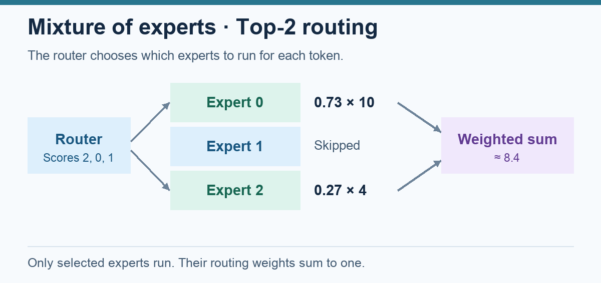

# Lab 1.6 · Mixture of experts

**Time** 15–20 minutes · **Hardware** CPU · **Software** Python 3 and Jupyter

[Open notebook](lab.ipynb) · [Exercise plan](#lab-plan) · [Results to look for](#results-to-look-for)

## Concepts you will use

A mixture-of-experts layer has multiple expert networks and a **router** that decides which ones to run for each token. The router produces one score per expert. In this lab, top-k routing keeps the k highest scores, normalizes them into weights with softmax, and combines the selected expert outputs. Trained models can use different scoring and normalization rules.

Suppose one token gives expert scores `[2, 0, 1]`. Top-1 uses expert 0 with weight 1. Top-2 uses experts 0 and 2 with weights of about `0.73` and `0.27`. If their outputs are 10 and 4, the combined output is about 8.4. Expert 1 is skipped in both runs.

The notebook supplies simple scalar expert functions and fixed router scores. Expert calls measure work in this example. If many tokens select the same expert, its call count can remain high even though most experts are skipped per token. In a distributed model, that imbalance can matter alongside communication and batching.

## Results to look for

1. Track expert IDs alongside their scores. A top-1 result gives its single expert all the weight.
2. Count calls for each expert and compare the maximum as well as the sum. The busiest expert can dominate a distributed step.

## Lab plan

| Exercise | What you will do | What to look for |
| --- | --- | --- |
| 1. Select and weight experts | Sort expert IDs by score, retain the best k, and normalize the selected scores with softmax. | Check the selected IDs, their order, and that the weights sum to one. Top-1 should give the selected expert full weight. |
| 2. Combine outputs and count calls | Route each token, run only its chosen experts, and accumulate the weighted output and per-expert counts. | Compare total calls and the busiest expert for top-1 and top-2. Also compare both with evaluating every expert for every token. |

Spend about 3–4 minutes on the worked example, 10–13 minutes on the exercises, and the last few minutes explaining the results.

## Per-token sparsity and batch coverage

Kiely distinguishes the experts selected for an individual token from the union of experts activated by a batch. Routing happens again at each mixture-of-experts layer. Our notebook models one layer. Even when each token uses only one expert, a batch with varied router scores can use every expert in the layer.

**Optional extension.** Compare a batch where every token routes to expert 0 with a batch in which different tokens prefer different experts. Keep top-k fixed at one and compare total assignments, distinct active experts, and the busiest expert.

## Apply it to an inference system

**Per-device load instead of average load.** Assume each expert is on a separate device and each call takes one unit of time. Use the per-expert counts to estimate the longest device queue under top-1 and top-2. State what this model leaves out, such as dispatch and expert batching.

## Run the lab

Follow the [local setup](../../../README.md#run-the-notebooks-locally), then open [lab.ipynb](lab.ipynb). Run the setup cell, replace each `return None` with your implementation, and run the check below it. Allow 15–20 minutes for the core exercises. The extension is optional.

**Reading** · Philip Kiely, *Inference Engineering* (Baseten Books), §2.2.4, pp. 53–54.

[Back to Chapter 1](../../README.md#llm-inference-and-architecture) · [Learning roadmap](../../../README.md#learning-roadmap)
