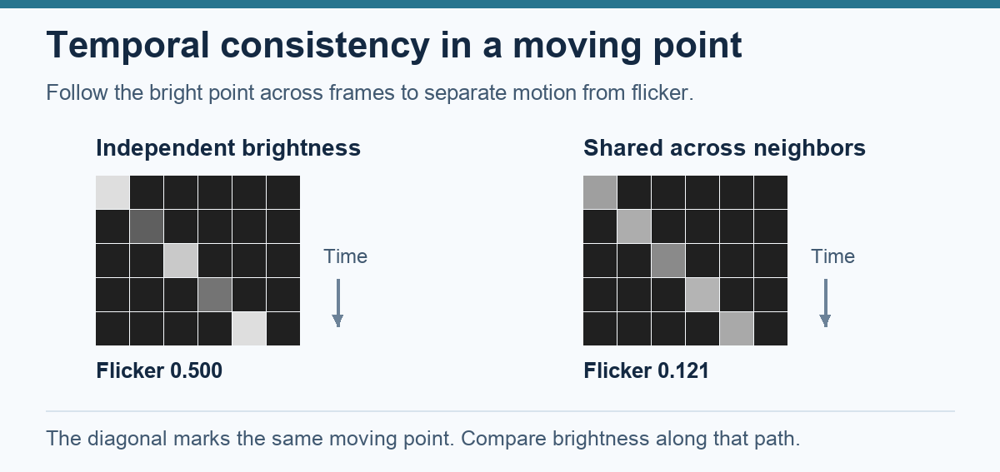
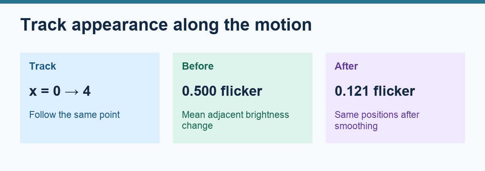

# Lab 1.10 · Video generation inference

**Time** 15–20 minutes · **Hardware** CPU · **Software** Python 3 and Jupyter

[Open notebook](lab.ipynb) · [Exercise plan](#lab-plan) · [Results to look for](#results-to-look-for)

Why does a sequence of plausible frames sometimes look wrong in motion?

A video adds a time axis to the image grid. If adjacent frames disagree about the appearance of the same moving object, the resulting flicker is easy to see. Video generators can model relationships across time as part of generation. Temporal attention is one way to let information from other frames influence the current frame. A video latent has a time axis alongside its spatial axes. This exercise uses an aligned brightness trace to isolate one consequence of sharing information over time.

This lab uses a moving bright point on a one-dimensional strip. The point at column 1 in one frame moves to column 2 in the next. Comparing pixel changes at fixed coordinates mixes the intended movement with changes in brightness. Aligning by the known motion lets us track the same point across frames. For a brightness trace [0.8, 0.4, 0.8], averaging each entry with its neighbors yields [0.6, 0.667, 0.6]. Real models must infer motion and preserve details without the supplied positions.

## Results to look for

1. Use a constant-brightness moving point as a control. The metric should be zero even though image coordinates change.
2. Check both flicker and the brightest-pixel positions. A useful change should preserve the intended motion in this experiment.

## Lab plan

| Exercise | What you will do | What to inspect |
| --- | --- | --- |
| 1. Measure flicker | Extract a motion-aligned trace and measure brightness changes. | Separate appearance changes from movement. |
| 2. Couple nearby frames | Smooth the aligned trace and rebuild the strip. | Check that flicker falls while the point keeps moving. |

## Framewise drift and joint updates

Kiely contrasts framewise generation, where small errors can propagate into subsequent frames, with joint denoising over a video latent with spatial and temporal axes. In a joint approach, a denoising step can update the clip together. Attention that spans time lets cues from one frame affect another. Full attention over all space-time tokens is one possible design. Its query-key pair count grows with the square of the token count.

The aligned smoothing experiment demonstrates shared information over time with known motion. It has no learned attention. The extension simulates cumulative framewise drift and counts pairs for full attention, connecting the consistency benefit to the compute constraint described in the book.

**Optional extension.** Start at position 0 and compare the intended move of one pixel per frame with a framewise predictor that advances by 1.1 pixels. Predict the drift after eight updates. Then double the number of frames at a fixed number of spatial tokens per frame and compare the query-key pair counts.

## Apply it to an inference system

**Measuring the cost of extra frames.** For full attention over a clip, keep spatial token count fixed and double the number of frames. Use the optional extension's pair count to estimate the change in work. Then propose a visual check that would catch oversmoothing of a deliberate flash.

## Run the lab

Follow the [local setup](../../../README.md#run-the-notebooks-locally), then open [lab.ipynb](lab.ipynb). Run the setup cell, replace each `return None` with your implementation, and run the check below it. Allow 15–20 minutes for the core exercises. The extension is optional.

| Time | Activity |
| --- | --- |
| 3 min | Read the setup and predict the first result. |
| 6 min | Complete and check the first implementation. |
| 6 min | Complete the second exercise and inspect the results. |
| 2–4 min | Explain what changed using the wrap-up questions. |

**Reading** · Philip Kiely, *Inference Engineering* (Baseten Books), §2.3.3, pp. 59–60.

[Back to Chapter 1](../../README.md#image-and-video-generation) · [Learning roadmap](../../../README.md#learning-roadmap)
