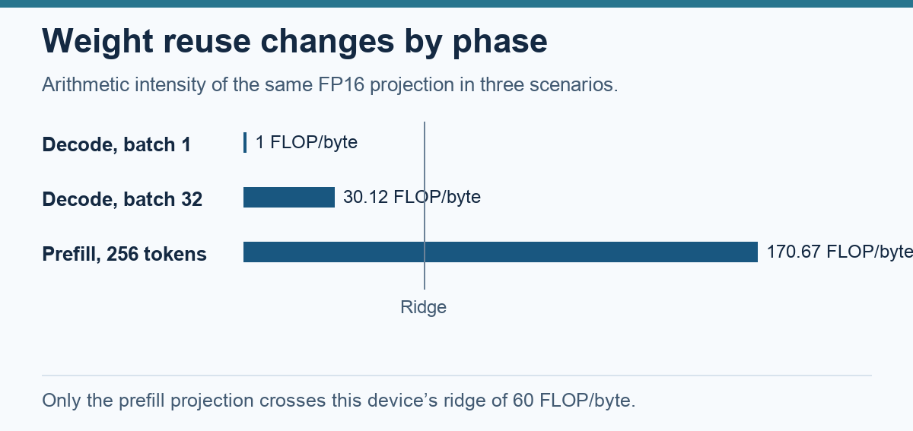
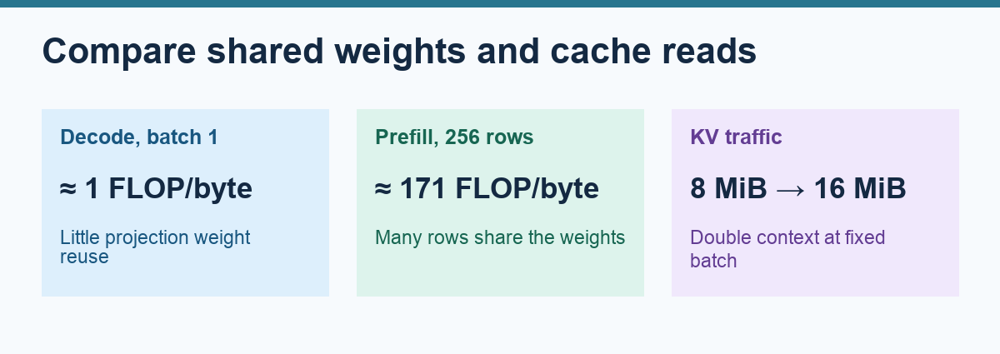

# Lab 1.13 · LLM prefill and decode bottlenecks

**Time** 15–20 minutes · **Hardware** CPU · **Software** Python 3 and Jupyter

[Open notebook](lab.ipynb) · [Exercise plan](#lab-plan) · [Results to look for](#results-to-look-for)

Why can the limiting resource change between the prompt and the generated tokens?

In Kiely's comparison, prefill processes many prompt positions together and can reuse model weights across those positions. One decode step processes one new position per active sequence and typically has less weight reuse. Batching decode requests increases reuse, while longer contexts can increase traffic from reading cached keys and values. These are tendencies. Shapes, hardware, and implementation can change the result.

We use two separate estimates. First, a FP16 projection has ideal intensity `2MKN / [2(MK + KN + MN)]` for M rows. For K=N=1024, M=1 gives about 1 FLOP/byte and M=256 about 171 FLOP/byte. Second, a cached attention step reads K and V for earlier tokens. With 4 key/value positions, 2 KV heads, a head width of 8, and 2 bytes per value, that is `2 × 4 × 2 × 8 × 2 = 256` bytes per layer per sequence. The factor of two counts the K and V arrays. A single cached query uses one row of scores per query head. A full multi-query attention calculation has more than one row.

Here, M counts rows processed together by a projection. Those rows can come from one long prompt or from several sequences during decode. The projection estimate assumes one weight read, while the KV estimate counts separate reads for each sequence. Compare them as two sources of work and traffic before reasoning about the whole model.

## Results to look for

1. The projection alone crosses the ridge in the higher-reuse case. Keep its conclusion scoped to that operation.
2. The cache estimate grows with sequences and context independently of the projection estimate. Check that your count includes both K and V.

## Lab plan

| Exercise | What you will do | What to inspect |
| --- | --- | --- |
| 1. Compare projection reuse | Vary rows for unbatched decode, batched decode, and prefill. | Which scenarios reach the ridge? |
| 2. Estimate KV reads | Vary context and batch size with a fixed KV head layout. | How much cache traffic grows independently of the shared weights? |

## Apply it to an inference system

The worked attention example on pp. 64–66 uses N query rows and an N × N score matrix. Those shapes describe a full-sequence calculation. For the one-token cached decode case in this lab, use one query row per query head and keys and values for all visible positions. Keep the book's method of counting work and traffic, and substitute the shapes of the operation you are analyzing.

**Separating shared and per-sequence traffic.** Estimate the KV reads for a batch with context lengths 512 and 1024 by summing the two single-sequence estimates. Compare with a model that reads both sequences up to the longest padded length. State which assumptions a profiler or runtime trace could validate.

## Run the lab

Follow the [local setup](../../../README.md#run-the-notebooks-locally), then open [lab.ipynb](lab.ipynb). Run the setup, make the predictions, then replace each `return None` placeholder and run its check. The notebook uses only the standard library and includes all inputs.

| Time | Activity |
| --- | --- |
| 3 min | Read the setup and predict the first result. |
| 6 min | Complete and check the first implementation. |
| 6 min | Complete the second exercise and inspect the results. |
| 2–4 min | Explain what changed using the wrap-up questions. |

Reading companion for Section 2.4.2, pp. 63–66 of *Inference Engineering* by Philip Kiely (Baseten Books).

[Back to Chapter 1](../../README.md#inference-bottlenecks) · [Learning roadmap](../../../README.md#learning-roadmap)
