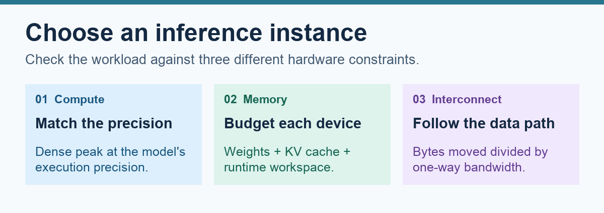

# Lab 2.1 · Choosing an inference instance

**Time** 15–20 minutes · **Hardware** CPU · **Software** Python 3 and Jupyter

[Open notebook](lab.ipynb) · [Exercise plan](#lab-plan) · [Interpret the results](#interpret-the-results)

You have to provision an interactive inference service. Can a smaller partition host a replica, and does the link matter if a larger model needs two devices?

## Concepts and worked example

A GPU spec sheet answers different questions. **Dense compute throughput** gives a peak rate at a stated precision. Use the dense figures at the workload's precision. An FP8 result and a sparse BF16 rating are different operating points. **Memory capacity** controls what can fit, while **memory bandwidth** describes how quickly data can be moved within the GPU. Neither predicts request latency by itself.

A **MIG partition** exposes a profile with its own compute and memory resources. Read the profile's usable memory directly. Fit requires space for weights, the request state, and runtime allocations. For a conventional decoder KV cache, count two arrays (K and V) per layer, with one vector per KV head at each cached token. A batch of unequal-length requests uses the sum of their cached token counts in this packed estimate. Alignment, allocation blocks, and runtime buffers can raise the actual requirement.

A multi-GPU deployment also has to move data between devices. Convert the effective one-way link rate to bytes per second before estimating a transfer floor. For example, 80 Gb/s is 10 GB/s, so a 20 MB payload takes at least 2 ms at that rate. A real collective can add synchronization, extra data movement, and contention. A link's peak rating also depends on how bandwidth is quoted.

The profiles and workload sizes in this lab are fictional, fixed inputs. They let you isolate the decisions without hardware access, live prices, or model downloads. All GB, MB, and link rates use decimal units.

## Lab plan

| Exercise | What you will do | What to look for |
| --- | --- | --- |
| 1. Compare compute quotes | Select the dense BF16 figures from two spec sheets. | An FP8 or sparse peak can reverse the ranking. |
| 2. Size a replica | Account for weights, workspace, and KV cache at two concurrency levels. | A partition can fit the short workload and run out of memory on the longer one. |
| 3. Check a multi-GPU path | Normalize bandwidth units and estimate a transfer floor for two links. | Identical accelerator layouts can have different communication costs. |

Spend about 3 minutes on the setup, 4 minutes comparing peaks, 6 minutes sizing the replica, and 4 minutes comparing links.

## Interpret the results

- Compare the BF16 dense rates as a compute ceiling. Attention and weight reads can still dominate.
- A positive memory margin means the replica fits the modeled budget. Check peak allocation with representative context lengths and concurrency before provisioning.
- If the transfer floor alone exceeds the communication budget, the link cannot meet that modeled budget. Passing this check leaves overhead and other traffic to measure.

## Run the lab

Follow the [local setup](../../README.md#run-the-notebooks-locally), then open [lab.ipynb](lab.ipynb). Replace the three `return None` placeholders and rerun the checks. The notebook uses the Python standard library.

**Reading** · Philip Kiely, *Inference Engineering* (Baseten Books), §§3.1–3.3, pp. 74–87.

[Back to Chapter 2](../README.md) · [Learning roadmap](../../README.md#learning-roadmap)
