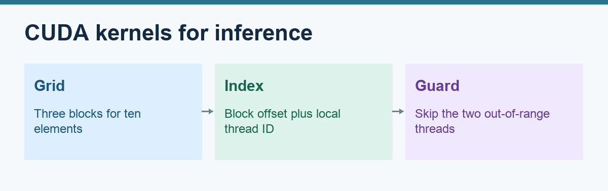

# Lab 3.1 · CUDA kernels for inference

**15–20 minutes · CPU**

[Open notebook](lab.ipynb) · [Exercise plan](#exercise-plan) · [Setup](#setup)

CUDA launches a grid of thread blocks. Within a one-dimensional launch, the global index is `blockIdx.x * blockDim.x + threadIdx.x`. With ten elements and four threads per block, three blocks launch twelve logical threads. A bounds check makes the last two skip the work. These are logical indices. The device schedules their execution.

You will trace that mapping for a ReLU kernel and compare it with a scalar reference. Elementwise kernels have independent work per element. A GEMM instead combines input values and generally uses a library implementation such as cuBLAS with tiling and reuse. The CPU trace models coverage and indexing. The optional CUDA C++ example launches the same ReLU operation on a GPU.

## Exercise plan

| Exercise | What you will do | What to look for |
| --- | --- | --- |
| 1. Plan a launch | Return the block count using integer ceiling division. A zero-length input requires no blocks. | The tail uses a partially active block, which is why the guard matters. |
| 2. Trace the kernel | For each block and local thread, compute its global index. Keep only valid indices and apply ReLU. Return the indices and outputs in order. | Matching the reference checks both the indexing and the mathematical operation. |

Spend about four minutes on setup and the example, six minutes on each exercise, and a few minutes interpreting the results.

## Setup

Start with the [local notebook setup](../../../README.md#run-the-notebooks-locally). The core exercises use only the Python standard library.

## Optional extension

On a machine with an NVIDIA GPU, a compatible CUDA toolkit, and `nvcc`, set `run_cuda = True` in the optional cell. The example uses managed memory and synchronizes before checking the result. This path is outside the CPU exercise.

## Reading

Philip Kiely, *Inference Engineering* (Baseten Books), §§4.1–4.1.1, pp. 96–98.

- [NVIDIA CUDA programming guide](https://docs.nvidia.com/cuda/cuda-programming-guide/02-basics/writing-cuda-kernels.html)
- [NVIDIA cuBLAS documentation](https://docs.nvidia.com/cuda/cublas/)

[Back to Chapter 3](../../README.md) · [Learning roadmap](../../../README.md#learning-roadmap)
