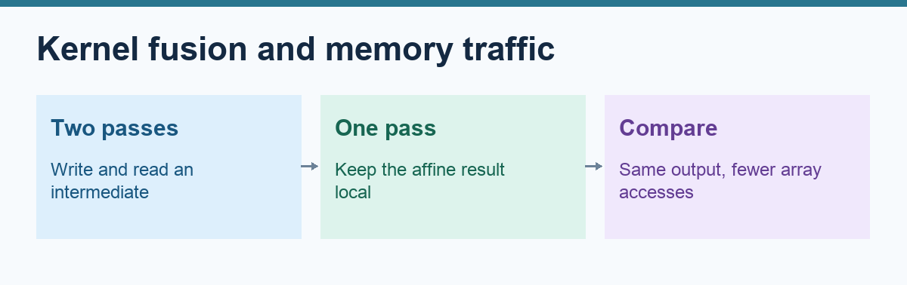

# Lab 3.3 · Kernel fusion and memory traffic

**15–20 minutes · CPU**

[Open notebook](lab.ipynb) · [Exercise plan](#exercise-plan) · [Setup](#setup)

Separate elementwise kernels typically write an intermediate that the next kernel must read. A fused kernel can keep the intermediate local to the thread. For `ReLU(2x + 1)` with x = −2, the intermediate is −3 and the final value is zero. Fusing preserves the order of those operations.

Model two passes as one array read and one array write each. For one million FP32 elements, that is 16 MB of logical array traffic. A fused pass accounts for 8 MB. Real DRAM traffic depends on cache behavior and implementation. The experiment compares output parity and counts modeled bytes.

## Exercise plan

| Exercise | What you will do | What to look for |
| --- | --- | --- |
| 1. Fuse the operation | Return ReLU(2x + 1) for each element in one pass. | The boundary case x = −0.5 tests the order of affine computation and activation. |
| 2. Count bytes | Return the logical bytes read and written across the requested number of passes. Include the final write. | The reduction comes from removing one write and one read of the intermediate. |

Spend about four minutes on setup and the example, six minutes on each exercise, and a few minutes interpreting the results.

## Setup

Start with the [local notebook setup](../../../README.md#run-the-notebooks-locally). The core exercises use only the Python standard library.

## Optional extension

Suppose another consumer also needs the affine output. Redo the byte budget when the fused operation must write that output as well. Explain why a profiler is needed to measure actual DRAM traffic.

## Reading

Philip Kiely, *Inference Engineering* (Baseten Books), §4.1.3, pp. 100–101.

- [NVIDIA CUDA programming guide](https://docs.nvidia.com/cuda/cuda-programming-guide/02-basics/writing-cuda-kernels.html)

[Back to Chapter 3](../../README.md) · [Learning roadmap](../../../README.md#learning-roadmap)
