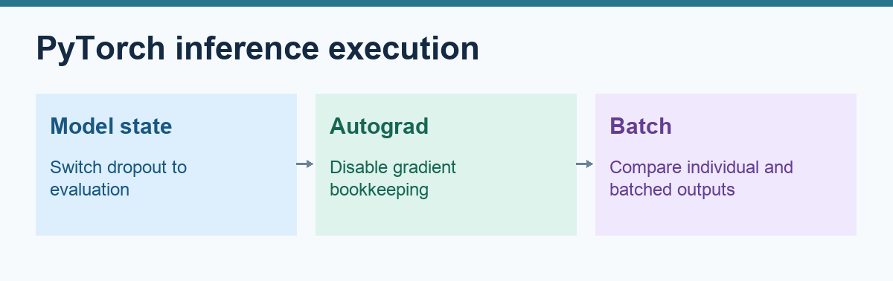

# Lab 3.4 · PyTorch inference execution

**15–20 minutes · CPU**

[Open notebook](lab.ipynb) · [Exercise plan](#exercise-plan) · [Setup](#setup)

In PyTorch, `eval()` switches modules such as dropout and batch normalization into evaluation behavior. `torch.inference_mode()` separately disables gradient tracking and other autograd bookkeeping. An inference service commonly uses both. Compilation with `torch.compile` is a further optimization and may specialize or fuse supported operations. Use a correctness reference before comparing timings.

This lab builds a small projection with dropout and runs it in different modes. A batch variable changes the number of rows passed to the same model. The inputs and weights are generated locally.



## Exercise plan

| Exercise | What you will do | What to look for |
| --- | --- | --- |
| 1. Configure inference | Put the model in evaluation mode and execute the forward pass inside torch.inference_mode(). | Evaluation changes the output because dropout is disabled. Inference mode changes autograd behavior. |
| 2. Compare batch shapes | Use run_inference on each one-row slice and concatenate the results along dimension zero. | Matching outputs makes it meaningful to benchmark the two batch strategies separately. |

Spend about four minutes on setup and the example, six minutes on each exercise, and a few minutes interpreting the results.

## Setup

Start with the [local notebook setup](../../../README.md#run-the-notebooks-locally). Install the following dependencies in the environment that runs your notebook. Tested with Python 3.9. The pinned versions are the reproducible CPU setup for this lab.

```sh
python -m pip install "numpy<2" torch==2.2.2
```

## Optional extension

Design an eager versus compiled comparison. Separate first-call compilation from steady-state time, vary batch size, and check parity before timing. On a GPU, synchronize at the measurement boundary.

## Reading

Philip Kiely, *Inference Engineering* (Baseten Books), §4.2.1, pp. 102–103.

- [PyTorch inference mode](https://docs.pytorch.org/docs/stable/generated/torch.autograd.grad_mode.inference_mode.html)
- [PyTorch compile](https://docs.pytorch.org/docs/stable/generated/torch.compile.html)

[Back to Chapter 3](../../README.md) · [Learning roadmap](../../../README.md#learning-roadmap)
