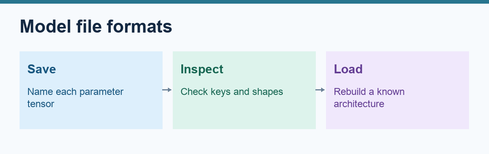

# Lab 3.5 · Model file formats

**15–20 minutes · CPU**

[Open notebook](lab.ipynb) · [Exercise plan](#exercise-plan) · [Setup](#setup)

A weights file stores tensors under names. A runtime still needs the architecture that interprets those names. Safetensors uses a metadata header and raw tensor data so a reader can inspect shapes and load selected tensors. ONNX can describe the computation graph as well as its initializers, which may also be stored externally for large models.

Generate a linear layer, save it as safetensors, and reconstruct it from the named tensors. The layer definition is already supplied. The practical check is whether the loaded parameters fit that definition and reproduce the reference output.



## Exercise plan

| Exercise | What you will do | What to look for |
| --- | --- | --- |
| 1. Inspect a weights file | Inside safe_open with framework='pt' and device='cpu', use its keys and each get_slice(key).get_shape() to return a dictionary of shape tuples. | PyTorch stores linear weights as output-by-input. The layer applies the corresponding transpose internally. |
| 2. Rebuild and compare | Load the file into a fresh nn.Linear(4, 3), using a strict state-dict load. Return the model in eval mode. | The matching output depends on the architecture as well as on the stored bytes. |

Spend about four minutes on setup and the example, six minutes on each exercise, and a few minutes interpreting the results.

## Setup

Start with the [local notebook setup](../../../README.md#run-the-notebooks-locally). Install the following dependencies in the environment that runs your notebook. Tested with Python 3.9. The pinned versions are the reproducible CPU setup for this lab.

```sh
python -m pip install "numpy<2" torch==2.2.2 safetensors==0.4.5
```

## Optional extension

Change the output width of the target layer and inspect the error from the strict load. Identify what model configuration would prevent that mismatch.

## Reading

Philip Kiely, *Inference Engineering* (Baseten Books), §4.2.2, pp. 103–104.

- [Safetensors PyTorch API](https://huggingface.co/docs/safetensors/api/torch)

[Back to Chapter 3](../../README.md) · [Learning roadmap](../../../README.md#learning-roadmap)
