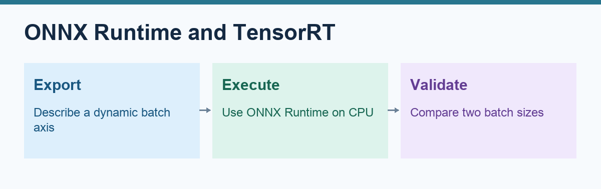

# Lab 3.6 · ONNX Runtime and TensorRT

**15–20 minutes · CPU**

[Open notebook](lab.ipynb) · [Exercise plan](#exercise-plan) · [Setup](#setup)

An ONNX export describes a graph contract: input names, dtypes, shapes, and operators. ONNX Runtime executes the graph with an execution provider. TensorRT can build a device-specific engine from a compatible graph. Dynamic dimensions in a TensorRT engine need a build profile, with min, optimum and max shapes.

This lab exports a small PyTorch model with a symbolic batch dimension. Run it through ONNX Runtime on CPU and compare two batch sizes. A successful export checks representability. Numerical parity still needs to be tested.



## Exercise plan

| Exercise | What you will do | What to look for |
| --- | --- | --- |
| 1. Export a dynamic graph | Write the model to BytesIO using torch.onnx.export. Name the input x and output y. Mark axis zero as batch for both and use opset 17. Return the bytes. | A symbolic batch dimension allows the same graph to accept different numbers of input rows. |
| 2. Verify numerical parity | Create a CPUExecutionProvider session from the bytes, run output y with input x, and return the output array. | Parity across shapes is evidence that the dynamic contract works for the cases you tested. |

Spend about four minutes on setup and the example, six minutes on each exercise, and a few minutes interpreting the results.

## Setup

Start with the [local notebook setup](../../../README.md#run-the-notebooks-locally). Install the following dependencies in the environment that runs your notebook. Tested with Python 3.9. The pinned versions are the reproducible CPU setup for this lab.

```sh
python -m pip install "numpy<2" torch==2.2.2 onnx==1.16.2 onnxruntime==1.19.2
```

## Optional extension

On a compatible NVIDIA TensorRT host, write the completed export with `Path('lab-model.onnx').write_bytes(graph_bytes)` after importing Path. Build an engine with `trtexec --onnx=lab-model.onnx --minShapes=x:1x4 --optShapes=x:4x4 --maxShapes=x:8x4 --saveEngine=lab-model.plan`. Then run `trtexec --loadEngine=lab-model.plan --shapes=x:4x4`. The optional TensorRT commands require a compatible GPU and installation. Compare engine build time and steady-state execution separately.

## Reading

Philip Kiely, *Inference Engineering* (Baseten Books), §4.2.3, pp. 104–105.

- [PyTorch ONNX export](https://docs.pytorch.org/docs/stable/onnx)
- [ONNX Runtime Python API](https://onnxruntime.ai/docs/api/python/api_summary.html)
- [NVIDIA TensorRT engine guide](https://docs.nvidia.com/deeplearning/tensorrt/latest/getting-started/build-your-first-engine.html)

[Back to Chapter 3](../../README.md) · [Learning roadmap](../../../README.md#learning-roadmap)
