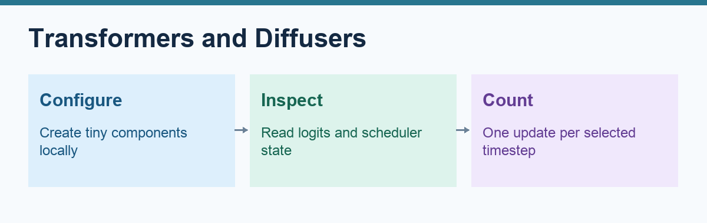

# Lab 3.7 · Transformers and Diffusers

**15–20 minutes · CPU**

[Open notebook](lab.ipynb) · [Exercise plan](#exercise-plan) · [Setup](#setup)

A Transformers configuration gives the model's shape contract. A causal LM takes token IDs and produces one vector of vocabulary logits per position. To choose a next token greedily, take argmax over the last position. Diffusers exposes another useful contract: a scheduler consumes the current sample, timestep, and model prediction, and produces the sample for the next step.

Use a randomly initialized tiny GPT-2 to inspect real output shapes and a Diffusers DDIM scheduler with a supplied zero predictor to inspect the loop. The components are configured locally. Meaningful text or image quality requires trained weights and a real denoiser.



## Exercise plan

| Exercise | What you will do | What to look for |
| --- | --- | --- |
| 1. Inspect causal-LM output | Run the model with input_ids under inference mode. Return the logits shape and a list of greedy next-token IDs, one per batch row. | The last dimension is tied to vocabulary size. Choosing the last position preserves one candidate per input sequence. |
| 2. Follow scheduler updates | Use set_timesteps(steps). For every timestep, call scheduler.step with a zero prediction of the same shape and the current sample. Feed prev_sample back into the next call. Return the final sample and list of timestep integers. | The scheduler controls the evaluation sequence. A real pipeline would supply a learned denoiser prediction at each step. |

Spend about four minutes on setup and the example, six minutes on each exercise, and a few minutes interpreting the results.

## Setup

Start with the [local notebook setup](../../../README.md#run-the-notebooks-locally). Install the following dependencies in the environment that runs your notebook. Tested with Python 3.9. The pinned versions are the reproducible CPU setup for this lab.

```sh
python -m pip install "numpy<2" torch==2.2.2 transformers==4.40.2 diffusers==0.30.3
```

## Optional extension

Compare scheduler step counts and final tensor norms for the same starting tensor. Explain what information a model card would need to supply before swapping real model components.

## Reading

Philip Kiely, *Inference Engineering* (Baseten Books), §4.2.4, p. 105.

- [Transformers GPT-2 configuration](https://huggingface.co/docs/transformers/model_doc/gpt2)
- [Diffusers DDIMScheduler](https://huggingface.co/docs/diffusers/api/schedulers/ddim)

[Back to Chapter 3](../../README.md) · [Learning roadmap](../../../README.md#learning-roadmap)
