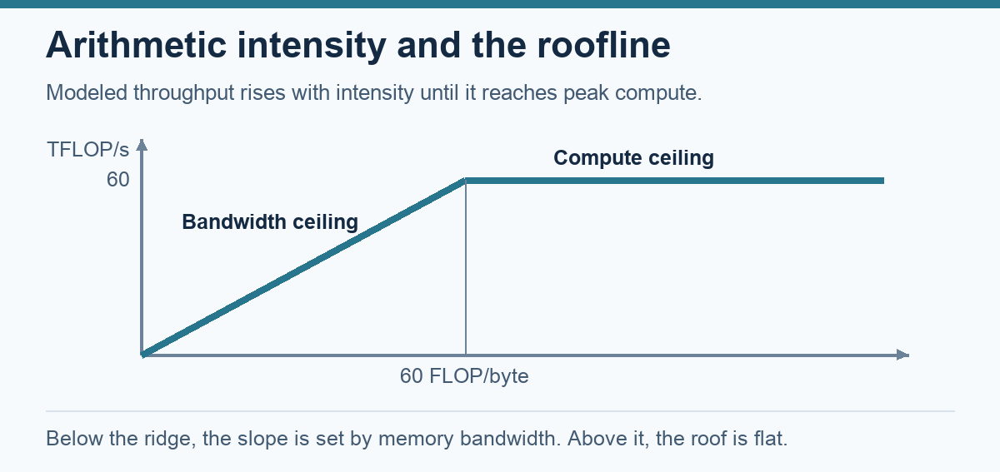

# Inference Engineering Labs

**Build the pieces of an inference engine, then work out what limits its performance.**

Implement causal attention, trace a token through prefill and decode, and use a roofline model to decide whether more compute or more memory bandwidth would help. The roadmap builds toward benchmarking and operating a serving stack.

[Start with the first lab](01-inside-a-model/01-neural-network-building-blocks/01-linear-layers-and-relu/README.md) · [Explore the roadmap](#learning-roadmap) · [Run the notebooks](#run-the-notebooks-locally)

**15 runnable labs** · **15–20 minutes each** · **Python standard library** · **CPU**



## Choose your starting point

| If you want to… | Start here |
| --- | --- |
| Understand what happens between a prompt and the next token | [LLM inference mechanics](01-inside-a-model/02-llm-inference-and-architecture/02-llm-inference-mechanics/README.md) |
| Diagnose why an operation is slow | [Arithmetic intensity and the roofline](01-inside-a-model/04-inference-bottlenecks/12-arithmetic-intensity/README.md) |
| See how a kernel can use less temporary memory | [Optimizing attention](01-inside-a-model/05-memory-efficient-attention/15-optimizing-attention/README.md) |

I started this project while reading Philip Kiely's *Inference Engineering* to turn the concepts into runnable experiments and share them with other engineers. The [introduction](00-introduction/README.md) explains the scope, intended audience, and requirements.

## Learning roadmap

| Chapter | Topics |
| --- | --- |
| [0. Introduction to inference engineering](00-introduction/README.md) | Motivation, workloads, and setup |
| [1. Inside a model](01-inside-a-model/README.md) | Model internals, generation, and bottlenecks |
| [2. Hardware for inference](02-hardware-for-inference/README.md) | Accelerators, GPU partitions, and interconnects |
| [3. Running and benchmarking models](03-running-and-benchmarking-models/README.md) | Runtimes, load testing, and profiling |
| [4. Optimizing generation](04-optimizing-generation/README.md) | Quantization, caching, and parallelism |
| [5. Inference beyond text](05-inference-beyond-text/README.md) | Vision, embeddings, speech, image, and video |
| [6. Operating an inference service](06-operating-an-inference-service/README.md) | Containers, scaling, observability, and rollouts |

| Subtopic status | Meaning |
| --- | --- |
| **Done** | The reading or all listed labs for the subtopic are published and verified. |
| **WIP** | The subtopic is partially published or in development. |
| **Coming soon** | The work is planned. |

## What to expect from a lab

The labs assume you can read Python, reason about time and space complexity, and debug a function from its failing checks. Prior experience with model internals or GPU programming is optional.

The current labs use small models and synthetic inputs so you can trace every step on a CPU. Each lab includes a guide, a worked example, and a notebook with implementation exercises and checks. Use the toy models to verify behavior and estimate work. The labs label theoretical costs and measured results explicitly. Each lab ends with an optional systems exercise that connects its toy implementation to an inference workload. Later labs will benchmark real models.

### Run the notebooks locally

From the repository root, create a virtual environment and launch JupyterLab.

```sh
python3 -m venv .venv
source .venv/bin/activate
python -m pip install jupyterlab
python -m jupyterlab
```

On Windows PowerShell, activate with `.venv\Scripts\Activate.ps1`. Open a lab's `lab.ipynb` and select the Python 3 kernel. The current exercises use the Python standard library. If a check asks you to complete a function, edit and rerun its definition before rerunning the check. Restart the kernel and run all cells in order to verify your finished notebook.

## Contributing

If you reproduce a lab and get a different result, open an issue with your hardware, software versions, run command, and measurements. Pull requests are welcome for reproducibility fixes, clearer explanations, and focused experiments that fit the roadmap.

## Credits and further reading

Thanks to Philip Kiely for *Inference Engineering* (Baseten Books), the primary reference for these labs. These sections provide background for the experiments.

- **Foundations and metrics** — Chapters 0 and 1 cover inference fundamentals, model selection, latency, and throughput.
- **Capacity and infrastructure** — Section 7.3 covers GPU provisioning and capacity across providers.
- **Glossary and further reading** — Appendices A and B.
