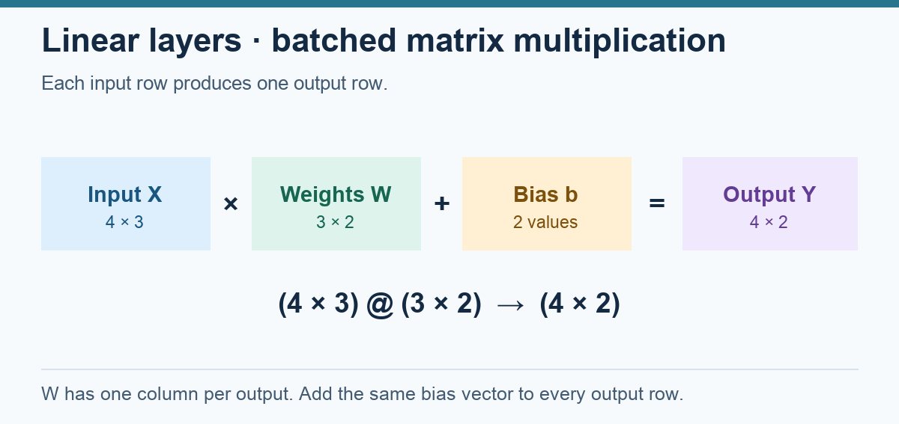

# Lab 1.1 · Linear layers, matrix multiplication, and ReLU

**Time** 15–20 minutes · **Hardware** CPU · **Software** Python 3 and Jupyter

## Concepts you will use

A linear layer computes one weighted sum per output and adds a bias. Think of a sample as a row of measurements. Each column of the weight matrix answers a different question about those same measurements.

With input `[2, 4]`, weights `[[3, 1], [-1, 2]]`, and bias `[1, -2]`, the first output is `2×3 + 4×(-1) + 1 = 3`. The second is `2×1 + 4×2 - 2 = 8`. The row index picks an input feature and the column index picks an output. The same weights and bias apply to every sample.

A batch stacks samples into rows, so `(batch, input) @ (input, output)` produces `(batch, output)`. The inner dimensions have to match. The outer dimensions tell you how many rows and columns you get. A tensor library can execute this operation with a matrix multiplication kernel. Here we use loops to expose the arithmetic.

The layer's weights and bias are fixed during inference. You can change the batch size without changing either parameter matrix or vector.

ReLU computes `max(0, x)` for each hidden value. Composing two affine layers gives another affine map with a constant slope. ReLU can switch a hidden feature on or off as the input crosses zero, which allows different slopes in different regions.

## Lab plan

| Exercise | What you will do | What to look for |
| --- | --- | --- |
| 1. Build a linear layer | Work through one output by hand, then implement the same calculation for every output column. | The zero-input case isolates the bias. The single-output case checks that your loop works for a different output width. |
| 2. Process a batch | Predict the output shape, then implement a matrix product and add the bias to each row. | The result must agree with applying your first function independently to each input row. Each row is one sample. |
| 3. Add ReLU | Implement the activation and compare two networks with the same weights, one with ReLU between the layers. | Look at the two hidden values before and after ReLU. The output bends at zero because a different hidden value survives on each side. |

Spend about 3–4 minutes on the worked example, 10–13 minutes on the exercises, and the last few minutes explaining the results.

## Composing affine layers

Build on Kiely's matrix composition example by tracking the biases too. With row-vector inputs, composing two affine layers gives weights `W1 @ W2` and bias `b1 @ W2 + b2`. In Exercise 3, inserting ReLU makes the slope depend on which hidden features are active.

**Optional extension.** Collapse the scalar layers `3x + 1` and `2h - 4` into one expression. Predict the result at x = −2, 0, and 2, then compare it with the composed network with ReLU in between.

## Apply it to an inference system

**Projection cost from a tensor shape.** An inference trace shows 128 rows entering a 1024 × 4096 projection. Estimate FLOP using two per multiply-accumulate. If the rows are reduced to 32, what happens to the FLOP count and the weight matrix size? See Lab 1.12 to turn those counts into a roofline estimate.

## Run the lab

Follow the [local setup](../../../README.md#run-the-notebooks-locally), then open [lab.ipynb](lab.ipynb). Run the setup cell, replace each `return None` with your implementation, and run the check below it. Allow 15–20 minutes for the core exercises. The extension is optional.

**Reading** · Philip Kiely, *Inference Engineering* (Baseten Books), §§2.1.1–2.1.2, pp. 44–46.

[Back to the learning roadmap](../../../README.md#learning-roadmap)
