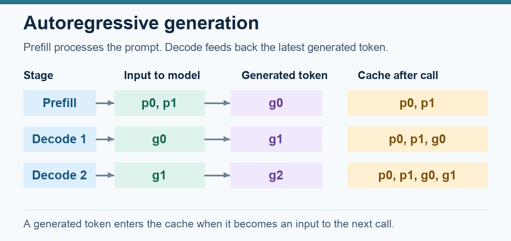

# Lab 1.2 · LLM inference mechanics

**Time** 15–20 minutes · **Hardware** CPU · **Software** Python 3 and Jupyter

## Concepts you will use

A decoder generates text one token at a time. A token is an integer ID representing a piece of text. A forward pass produces scores for possible next tokens, and greedy selection picks the highest score.

**Prefill** processes the entire prompt and gives you the scores used to pick the first generated token. In a real transformer, this pass also saves attention keys and values for the prompt positions in a **KV cache**. **Decode** then processes the latest generated token, reads the cached state, and picks another token. The last generated token has yet to enter the cache until it is fed back in.

For a two-token prompt and three generated tokens, the cached path processes input lengths `2 + 1 + 1 = 4`. Recomputing from scratch processes `2 + 3 + 4 = 9`. Both should generate the same tokens. The notebook stores IDs as a stand-in for key/value tensors and counts IDs passed to the model. Real attention still reads earlier cache entries, so these counts do not predict elapsed time.

## Lab plan

| Exercise | What you will do | What to look for |
| --- | --- | --- |
| 1. Prefill once | Pass the entire prompt into a fresh cache, then choose the first generated token from the scores. | Inspect the returned cache and first token separately. The cache contains the prompt while the token is ready for the next call. |
| 2. Decode and compare | Build the cached loop, then compare its token sequence and work count with the supplied recomputation loop. | Identical generated IDs establish that reuse preserved the result. Compare the input counts for one output token and for a longer generation. |

Spend about 3–4 minutes on the worked example, 10–13 minutes on the exercises, and the last few minutes explaining the results.

## Run the lab

Open [lab.ipynb](lab.ipynb) in Jupyter with a Python 3 kernel. Run the setup, replace each `return None` placeholder, and run the check directly below it. The notebook uses only the Python standard library and includes the inputs.

Reading companion for Section 2.2 of *Inference Engineering* by Philip Kiely (Baseten Books).

[Back to the learning roadmap](../../../README.md#learning-roadmap)
