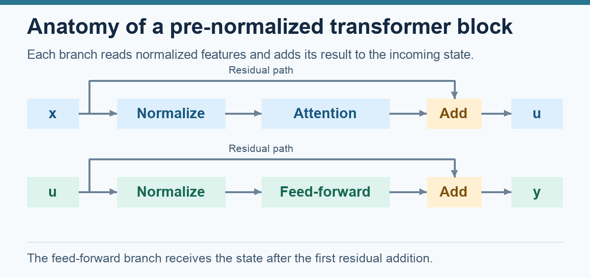
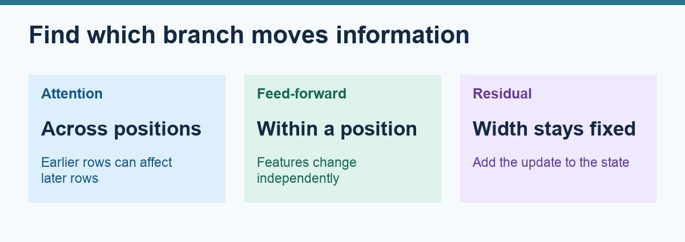

# Lab 1.4 · Transformer blocks

**Time** 15–20 minutes · **Hardware** CPU · **Software** Python 3 and Jupyter

[Open notebook](lab.ipynb) · [Exercise plan](#lab-plan) · [Results to look for](#results-to-look-for)

## Concepts you will use

A decoder block has two different jobs. Its attention branch lets earlier positions influence the current one. Its feed-forward branch transforms features within each position. Both branches return the same shape as their input so the block can add their outputs back to the hidden state. These additions are called **residual connections**.

In a pre-normalized block, the branch sees normalized features while the residual path carries the incoming features directly. For example, if a row is `[3, 1]` and the branch returns `[-1, 2]`, the updated row is `[2, 3]`. The second branch reads this updated row after normalization. In the notebook, normalization is RMS-based and applied independently to each row. It divides features by their root mean square with a small epsilon for numerical stability.

The notebook supplies prefix averaging as a stand-in for causal attention and a tiny ReLU feature transform as the feed-forward branch. Turning branches off lets you separate cross-position mixing from within-position transformations. Lab 1.5 replaces the averaging idea with explicit attention scores.

## Results to look for

1. Compare the output shape with the input shape. Each feature must receive the matching branch update.
2. Change an early row and compare the ablations. Only the attention stand-in can transmit that change to another position.

## Lab plan

| Exercise | What you will do | What to look for |
| --- | --- | --- |
| 1. Wire a residual update | Implement elementwise addition for two matrices of identical shape, then use it for the mixing branch. | Each feature receives its own update and the output has the same sequence length and hidden width. |
| 2. Assemble and ablate | Run both updates in order and compare with runs that disable one branch at a time. | Change an early input and inspect later rows. Without the mixing branch, an earlier row cannot change a later row. |

Spend about 3–4 minutes on the worked example, 10–13 minutes on the exercises, and the last few minutes explaining the results.

## Hidden width and feed-forward weights

The book separates the embedding, repeated blocks, and vocabulary head. Within a block it distinguishes attention, normalization, and the feed-forward network. The toy feed-forward function stands in for a position-wise network. In a simple two-projection version, the intermediate width can be larger than the residual width.

**Optional extension.** Count the weights for the expansion and contraction of a width-4 feed-forward branch with intermediate widths 8 and 16. Explain why the output can still be added to a width-4 residual.

## Apply it to an inference system

**Isolating a bad block output.** Pick one position where the full block and the attention-only run differ. Trace the normalized row and the feed-forward update. Explain where you would insert a shape check or comparison if a fused implementation disagreed with the reference.

## Run the lab

Follow the [local setup](../../../README.md#run-the-notebooks-locally), then open [lab.ipynb](lab.ipynb). Run the setup cell, replace each `return None` with your implementation, and run the check below it. Allow 15–20 minutes for the core exercises. The extension is optional.

**Reading** · Philip Kiely, *Inference Engineering* (Baseten Books), §2.2.2, pp. 50–51.

[Back to the learning roadmap](../../../README.md#learning-roadmap)
