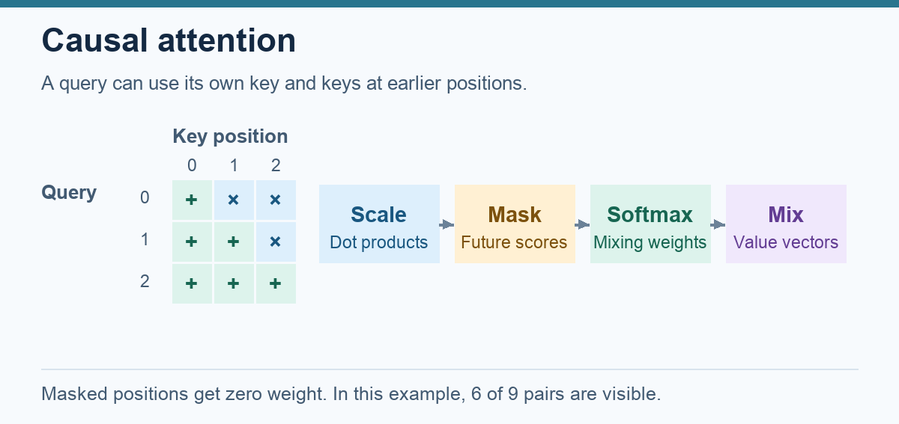

# Lab 1.5 · Causal attention

**Time** 15–20 minutes · **Hardware** CPU · **Software** Python 3 and Jupyter

## Concepts you will use

Attention uses a **query** to ask what information is relevant, a **key** to score how well each source position matches, and a **value** to supply the information to mix. For one query, take its dot product with each key and divide by the square root of the key width. Softmax turns the resulting scores into nonnegative weights that sum to one.

For query `[1, 0]` and keys `[1, 0]` and `[0, 1]`, the scaled scores are about `[0.707, 0]`. If both keys are visible, the weights are about `[0.67, 0.33]`. With values `[3, 0]` and `[0, 6]`, the weighted output is about `[2.01, 1.98]`.

**Causal** attention means position i can read positions up to and including i. For the first query in the example, masking the second score before softmax gives weights `[1, 0]` and output `[3, 0]`. The notebook holds queries, keys, and values fixed so you can isolate what scoring and masking do.

## Lab plan

| Exercise | What you will do | What to look for |
| --- | --- | --- |
| 1. Score and mask keys | Compute one scaled dot product per key. Use negative infinity for future keys when the causal mask is enabled. | Inspect the first softmax row. The first position can only attend to itself, so all weight goes to that key. |
| 2. Mix values and test causality | Use the weights to build the output vector, then change only the final value and compare masked and unmasked runs. | With masking, the final value can affect the last output, while earlier outputs stay fixed. The unmasked run provides a comparison. |

Spend about 3–4 minutes on the worked example, 10–13 minutes on the exercises, and the last few minutes explaining the results.

## Run the lab

Open [lab.ipynb](lab.ipynb) in Jupyter with a Python 3 kernel. Run the setup, replace each `return None` placeholder, and run the check directly below it. The notebook uses only the Python standard library and includes the inputs.

Reading companion for Section 2.2 of *Inference Engineering* by Philip Kiely (Baseten Books).

[Back to the learning roadmap](../../../README.md#learning-roadmap)
