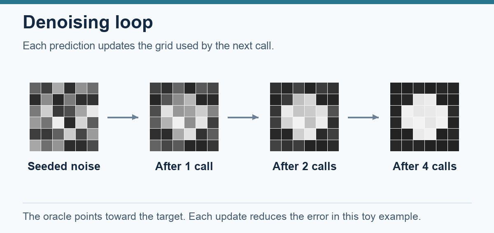

# Lab 1.7 · Image generation inference mechanics

**Time** 15–20 minutes · **Hardware** CPU · **Software** Python 3 and Jupyter

Why does an image generator call its denoiser repeatedly?

A diffusion-style pipeline starts with random values. At each step the model estimates a direction for changing the current sample. A **scheduler** determines the noise levels or timesteps to visit and how to use each prediction to update the sample. The updated sample becomes the next model input. In many pipelines this loop runs on a latent grid, which is decoded into pixels at the end.

We will use a 6 × 6 pixel grid and a supplied **oracle** that knows the target. This makes the update easy to follow. A trained denoiser predicts a quantity the scheduler can use, such as noise, velocity, or a clean sample estimate. The oracle returns an update direction directly to isolate the loop. In this lab, if the current pixel is 0.8 and the oracle target is 0.2, the direction is −0.6. A step of size 0.5 produces 0.5. Repeating the same rule gives 0.35.

## Lab plan

| Exercise | What you will do | What to inspect |
| --- | --- | --- |
| 1. Update a grid | Apply one predicted direction with two step sizes. | Compare the same pixel before and after the update. |
| 2. Run the loop | Feed each updated grid into the next prediction. | Inspect the snapshots, error, and number of model calls. |

## Guidance and model evaluations

Kiely contrasts the full-grid update of image denoising with the token-by-token loop in the LLM labs. He also describes **classifier-free guidance**, where a denoising step can evaluate both a conditional and an unconditional prediction. With the convention used here, the guided direction is `unconditional + scale × (conditional − unconditional)`. At scale 0 it equals the unconditional direction, and at scale 1 it equals the conditional direction. A runtime may batch both predictions into one call, so count prediction branches separately from Python calls or elapsed time. A negative prompt can supply the baseline conditioning in pipelines that support it.

The oracle loop above uses one prediction per step. The extension below isolates guidance at a single cell and accounts for the extra branch.

**Optional extension.** For unconditional direction −0.2 and conditional direction 0.1, predict the result at scales 0, 1, and 2. Change the scale and compare to the original predictions. How many branch evaluations would your four-step loop require with both branches enabled on every step?

## Apply it to an inference system

**Accounting for guidance work.** A trace shows 20 scheduler steps and 20 batched denoiser calls, each containing a conditional and a baseline prediction. Report the step count, call count, and number of prediction branches separately. Which would you pair with measured time to compare another runtime?

## Run the lab

Follow the [local setup](../../../README.md#run-the-notebooks-locally), then open [lab.ipynb](lab.ipynb). Run the setup cell, replace each `return None` with your implementation, and run the check below it. Allow 15–20 minutes for the core exercises. The extension is optional.

| Time | Activity |
| --- | --- |
| 3 min | Read the setup and predict the first result. |
| 6 min | Complete and check the first implementation. |
| 6 min | Complete the second exercise and inspect the results. |
| 2–4 min | Explain what changed using the wrap-up questions. |

**Reading** · Philip Kiely, *Inference Engineering* (Baseten Books), §2.3, pp. 55–56.

[Back to the learning roadmap](../../../README.md#learning-roadmap)
