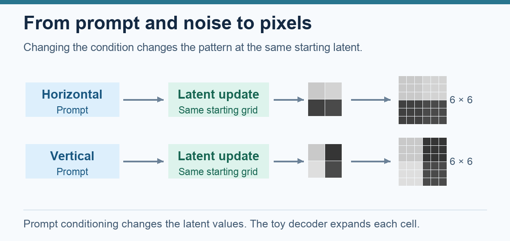

# Lab 1.8 · Image generation model architecture

**Time** 15–20 minutes · **Hardware** CPU · **Software** Python 3 and Jupyter

Why separate text conditioning, denoising, and decoding?

In a text-conditioned latent pipeline, a **text encoder** represents the prompt, a **denoiser** uses that representation while updating a noisy latent grid, and an **image decoder** converts the final latent into pixels. A latent is an internal representation. Running repeated model evaluations on a smaller spatial grid can reduce work, although actual cost also depends on channels and architecture.

The notebook uses a prompt lookup instead of a text encoder, one supplied conditional update, and nearest-neighbor expansion instead of a learned decoder. For example, expanding the row [0.2, 0.8] by a factor of two gives [0.2, 0.2, 0.8, 0.8]. Repeat rows too, so a 2 × 2 latent becomes 4 × 4. Keep the starting latent fixed to isolate the effect of changing the prompt.

| Exercise | What you will do | What to inspect |
| --- | --- | --- |
| 1. Connect conditioning | Look up the prompt and pass it to one latent update. | The latent shape stays fixed while its values change. |
| 2. Decode to pixels | Expand each latent cell and compare two prompts. | The output shape grows and the prompt changes the pattern. |

## Run the lab

Open [lab.ipynb](lab.ipynb) in Jupyter and select a Python 3 kernel. Run the setup, make the predictions, then complete each TODO and run its check. The notebook uses only the standard library and includes all inputs.

| Time | Activity |
| --- | --- |
| 3 min | Read the setup and predict the first result. |
| 6 min | Complete and check the first implementation. |
| 6 min | Complete the second exercise and inspect the results. |
| 2–4 min | Explain what changed using the wrap-up questions. |

Reading companion for Section 2.3 of *Inference Engineering* by Philip Kiely (Baseten Books).

[Back to the learning roadmap](../../../README.md#learning-roadmap)
