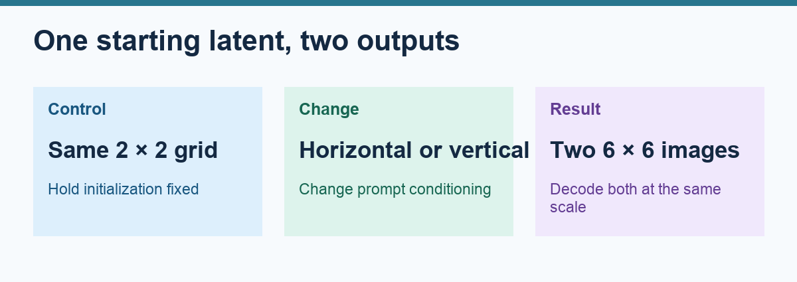

# Lab 1.8 · Image generation model architecture

**Time** 15–20 minutes · **Hardware** CPU · **Software** Python 3 and Jupyter

[Open notebook](lab.ipynb) · [Exercise plan](#lab-plan) · [Results to look for](#results-to-look-for)

Why separate text conditioning, denoising, and decoding?

In a text-conditioned latent pipeline, a **text encoder** represents the prompt, a **denoiser** uses that representation while updating a noisy latent grid, and an **image decoder** converts the final latent into pixels. A latent is an internal representation. The image decoder, often the decoder side of a variational autoencoder (VAE), maps that representation back to pixels. Running repeated model evaluations on a smaller spatial grid can reduce work, although actual cost also depends on channels and architecture.

The notebook uses a prompt lookup instead of a text encoder, one supplied conditional update, and nearest-neighbor expansion instead of a learned decoder. For example, expanding the row [0.2, 0.8] by a factor of two gives [0.2, 0.2, 0.8, 0.8]. Repeat rows too, so a 2 × 2 latent becomes 4 × 4. Keep the starting latent fixed to isolate the effect of changing the prompt.

## Results to look for

1. Compare cells that differ between prompt conditions. Both runs should preserve the latent shape.
2. Expansion makes the grid larger. The pattern difference comes from conditioning before the decoder.

## Lab plan

| Exercise | What you will do | What to inspect |
| --- | --- | --- |
| 1. Connect conditioning | Look up the prompt and pass it to one latent update. | The latent shape stays fixed while its values change. |
| 2. Decode to pixels | Expand each latent cell and compare two prompts. | The output shape grows and the prompt changes the pattern. |

## Patches and a refinement stage

The book uses **SDXL** to illustrate how a pipeline can have a base denoiser and a refiner before the VAE decodes the result. The base establishes the image, while the refiner can improve details. Its comparison with Qwen Image also shows why replacing one pipeline component, such as the text encoder, can change the cost of serving the model.

A diffusion transformer can group regions of the latent grid into **patch tokens**, so attention operates over a sequence of patches. Our prompt lookup and grid expansion model the component interfaces. They approximate neither the learned VAE nor the denoiser's internal attention. The exercise below uses non-overlapping patches and a single full attention operation to isolate how token count grows with grid resolution.

**Optional extension.** Compare 4 × 4 and 8 × 8 latent grids using 2 × 2 patches. Count the tokens and the query-key pairs for full attention. Then trace where a refiner would fit between the lab's latent update and decoder. Which shape would it have to return to keep the decoder interface unchanged?

## Apply it to an inference system

**Finding the repeated work in a pipeline.** A trace reports 30 ms for text encoding, 12 ms per denoising step, and 30 ms for decoding. Estimate total time at 20 and 10 steps assuming no overlap and no other work. Where would a refiner factor into the accounting?

## Run the lab

Follow the [local setup](../../../README.md#run-the-notebooks-locally), then open [lab.ipynb](lab.ipynb). Run the setup cell, replace each `return None` with your implementation, and run the check below it. Allow 15–20 minutes for the core exercises. The extension is optional.

| Time | Activity |
| --- | --- |
| 3 min | Read the setup and predict the first result. |
| 6 min | Complete and check the first implementation. |
| 6 min | Complete the second exercise and inspect the results. |
| 2–4 min | Explain what changed using the wrap-up questions. |

**Reading** · Philip Kiely, *Inference Engineering* (Baseten Books), §2.3.1, pp. 57–58.

[Back to the learning roadmap](../../../README.md#learning-roadmap)
