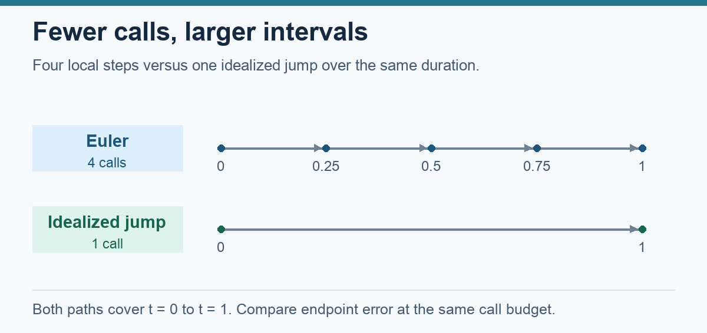

# Lab 1.9 · Few-step image generation

**Time** 15–20 minutes · **Hardware** CPU · **Software** Python 3 and Jupyter

What is the cost of using fewer denoising steps, and why might a model be trained specifically for that regime?

A solver advances the sample along a path described by model predictions. With a simple Euler update, each call estimates the local direction and holds it fixed for one interval. Bigger intervals mean fewer calls. When the direction varies with the sample, a large interval can introduce more error. Few-step models can be trained to make useful progress over larger intervals, for example by learning from the endpoints of a slower teacher trajectory.

This lab uses the scalar equation dx/dt = −x. Its exact evolution over an interval h multiplies the value by exp(−h). Starting at 1, one Euler step of size 0.5 gives 0.5, while the exact value at that time is about 0.607. We provide the exact interval update as an idealized stand-in for a learned jump. The endpoint error measures this equation only. The model-call count is a work proxy.

| Exercise | What you will do | What to inspect |
| --- | --- | --- |
| 1. Compare step budgets | Integrate to the same end time with different Euler budgets. | Record endpoint error and calls. |
| 2. Compare update rules | Swap in the supplied interval update at the same budgets. | Separate the effect of the step count from the effect of the update rule. |

## What the training changes

Kiely discusses two ways to design a generator for a small number of evaluations. **Latent consistency** trains predictions made at different points along a denoising trajectory to agree on the destination. A few evaluations can progressively improve the result. **Distillation** trains a student using a teacher, for example by learning an update that covers multiple smaller teacher steps. Choosing a smaller step budget for an unchanged model leaves its learned predictions unchanged.

The exact jump in this notebook stands in for an ideal prediction. It is computed analytically. The extension constructs a fixed two-step teacher target to show what a student could learn from, then compares that target with a single large Euler step.

**Optional extension.** From input 1.0, compare two teacher steps of size 0.25 with one Euler step of size 0.5. Both reach the same time. Repeat from 0.8. If a student could reproduce each teacher endpoint in one evaluation, what would be saved? How would you check whether the student preserved quality on unseen prompts?

## Run the lab

Open [lab.ipynb](lab.ipynb) in Jupyter and select a Python 3 kernel. Run the setup, make the predictions, then complete each TODO and run its check. The notebook uses only the standard library and includes all inputs.

| Time | Activity |
| --- | --- |
| 3 min | Read the setup and predict the first result. |
| 6 min | Complete and check the first implementation. |
| 6 min | Complete the second exercise and inspect the results. |
| 2–4 min | Explain what changed using the wrap-up questions. |

Reading companion for Section 2.3.2, p. 59 of *Inference Engineering* by Philip Kiely (Baseten Books).

[Back to the learning roadmap](../../../README.md#learning-roadmap)
