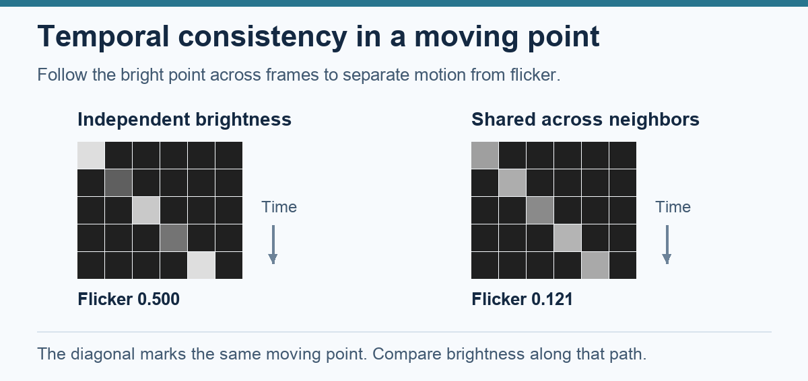

# Lab 1.10 · Video generation inference

**Time** 15–20 minutes · **Hardware** CPU · **Software** Python 3 and Jupyter

Why does a sequence of plausible frames sometimes look wrong in motion?

A video adds a time axis to the image grid. If adjacent frames disagree about the appearance of the same moving object, the resulting flicker is easy to see. Video generators can model relationships across time as part of generation. Temporal attention is one way to let information from other frames influence the current frame.

This lab uses a moving bright point on a one-dimensional strip. The point at column 1 in one frame moves to column 2 in the next. Comparing pixel changes at fixed coordinates mixes the intended movement with changes in brightness. Aligning by the known motion lets us track the same point across frames. For a brightness trace [0.8, 0.4, 0.8], averaging each entry with its neighbors yields [0.6, 0.667, 0.6]. Real models must infer motion and preserve details without the supplied positions.

| Exercise | What you will do | What to inspect |
| --- | --- | --- |
| 1. Measure flicker | Extract a motion-aligned trace and measure brightness changes. | Separate appearance changes from movement. |
| 2. Couple nearby frames | Smooth the aligned trace and rebuild the strip. | Check that flicker falls while the point keeps moving. |

## Run the lab

Open [lab.ipynb](lab.ipynb) in Jupyter and select a Python 3 kernel. Run the setup, make the predictions, then complete each TODO and run its check. The notebook uses only the standard library and includes all inputs.

| Time | Activity |
| --- | --- |
| 3 min | Read the setup and predict the first result. |
| 6 min | Complete and check the first implementation. |
| 6 min | Complete the second exercise and inspect the results. |
| 2–4 min | Explain what changed using the wrap-up questions. |

Reading companion for Section 2.3 of *Inference Engineering* by Philip Kiely (Baseten Books).

[Back to the learning roadmap](../../../README.md#learning-roadmap)
