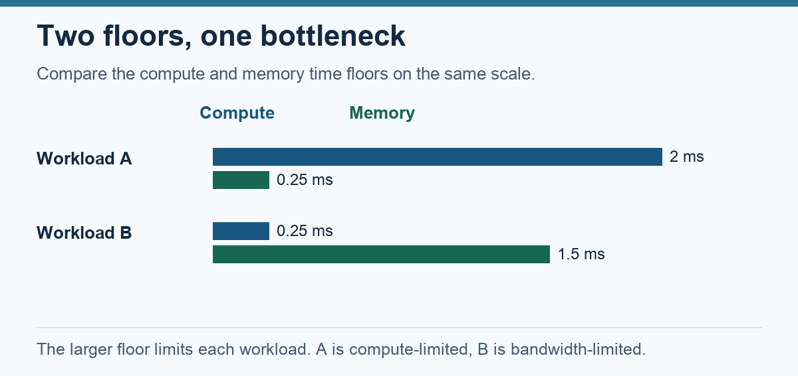

# Lab 1.11 · Diagnosing inference bottlenecks

**Time** 15–20 minutes · **Hardware** CPU · **Software** Python 3 and Jupyter

Which resource should you improve first?

Kiely starts with two resources. **Compute throughput** tells you how many floating-point operations the hardware can execute per second. **Memory bandwidth** tells you how many bytes it can move per second. Work divided by throughput gives a compute time floor. Traffic divided by bandwidth gives a movement time floor. If both resources could overlap perfectly, execution would still take at least the larger of the two. Real latency can be longer because of imperfect overlap, synchronization, or overhead.

For 3 GFLOP and 100 MB on a device with 6 TFLOP/s and 200 GB/s, the two floors are both 0.5 ms. Doubling only compute leaves the movement floor at 0.5 ms. The point of the calculation is to rule in promising optimizations before measuring them.

## Lab plan

| Exercise | What you will do | What to inspect |
| --- | --- | --- |
| 1. Calculate time floors | Compute the two resource times and identify the larger. | Which workload is limited by which resource? |
| 2. Change one resource | Try faster compute and faster memory separately. | Which intervention improves the modeled latency? |

## Run the lab

Follow the [local setup](../../../README.md#run-the-notebooks-locally), then open [lab.ipynb](lab.ipynb). Run the setup, make the predictions, then complete each TODO and run its check. The notebook uses only the standard library and includes all inputs.

| Time | Activity |
| --- | --- |
| 3 min | Read the setup and predict the first result. |
| 6 min | Complete and check the first implementation. |
| 6 min | Complete the second exercise and inspect the results. |
| 2–4 min | Explain what changed using the wrap-up questions. |

Reading companion for Section 2.4, pp. 61–62 of *Inference Engineering* by Philip Kiely (Baseten Books).

[Back to the learning roadmap](../../../README.md#learning-roadmap)
