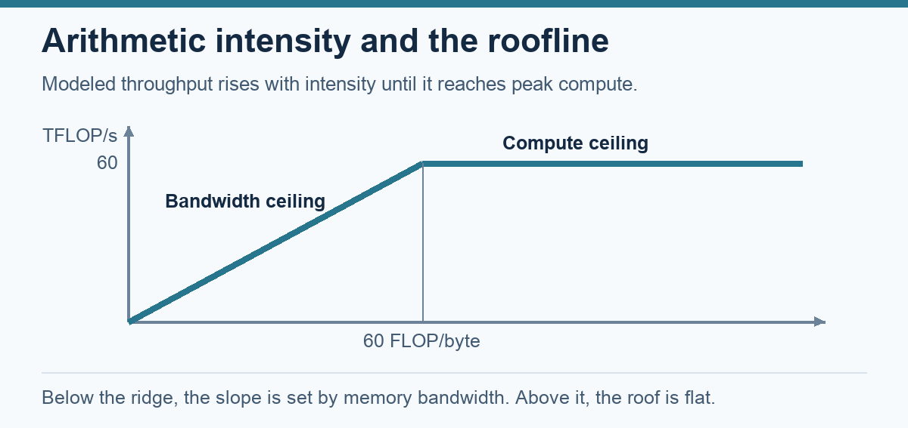
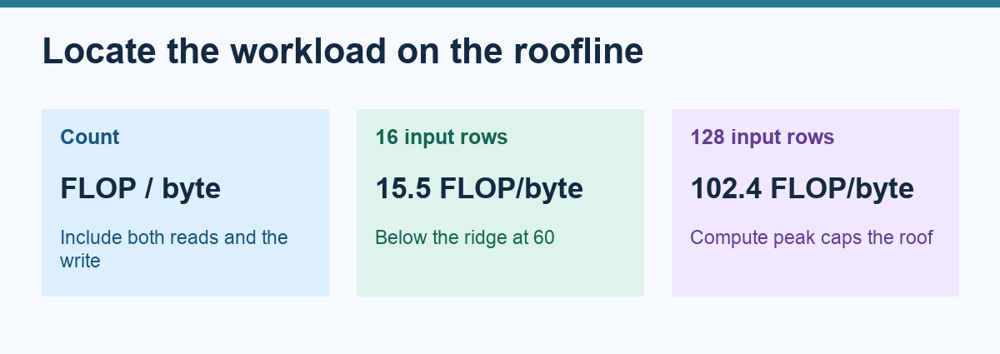

# Lab 1.12 · Arithmetic intensity and the roofline

**Time** 15–20 minutes · **Hardware** CPU · **Software** Python 3 and Jupyter

[Open notebook](lab.ipynb) · [Exercise plan](#lab-plan) · [Results to look for](#results-to-look-for)

Why do two operations on the same GPU hit different ceilings?

The hardware ratio `peak FLOP/s ÷ bandwidth bytes/s` gives a **ridge point** in FLOP per byte. An operation's **arithmetic intensity** is its total FLOP divided by bytes moved across a specified memory boundary. Below the ridge, the bandwidth ceiling is `intensity × bandwidth`. Above it, the compute peak sets the roof. This lab uses an illustrative device with 60 TFLOP/s and 1 TB/s, so the ridge is 60 FLOP/byte. The book uses the same calculation with an H100 example.

For a matrix product `(M × K) @ (K × N)`, count about `2MKN` FLOP using two per multiply-accumulate. In an idealized traffic model, read both inputs once and write the output once. At FP16, the total is `2(MK + KN + MN)` bytes. For M=2, K=3, N=4 that gives 48 FLOP and 52 bytes. Real traffic depends on tiling, caching, and data layout.

Use rates and byte counts for the same memory boundary. For example, compare DRAM traffic with DRAM bandwidth. The roof is an upper bound on throughput. A point below it may reflect overhead or an implementation that does not saturate either resource.

## Results to look for

1. Use the matrix dimensions to check each traffic term separately. Intensity rises as more input rows share the weight matrix.
2. Compare the two throughput ceilings in the same units. A modeled ceiling is a bound, so measured throughput can be lower.

## Lab plan

| Exercise | What you will do | What to inspect |
| --- | --- | --- |
| 1. Count matmul work | Calculate FLOP and modeled memory traffic. | How does reuse change as M grows? |
| 2. Apply the roofline | Convert intensity into a throughput ceiling. | Where does the ceiling stop rising? |

## Apply it to an inference system

**Precision and the roofline.** Change only the modeled bytes per value and locate the new point on the existing roofline. Then explain what would have to change in the roof itself if the device's peak compute rate differed at the new precision.

## Run the lab

Follow the [local setup](../../../README.md#run-the-notebooks-locally), then open [lab.ipynb](lab.ipynb). Run the setup, make the predictions, then replace each `return None` placeholder and run its check. The notebook uses only the standard library and includes all inputs.

| Time | Activity |
| --- | --- |
| 3 min | Read the setup and predict the first result. |
| 6 min | Complete and check the first implementation. |
| 6 min | Complete the second exercise and inspect the results. |
| 2–4 min | Explain what changed using the wrap-up questions. |

Reading companion for Section 2.4.1, pp. 62–63 of *Inference Engineering* by Philip Kiely (Baseten Books).

[Back to the learning roadmap](../../../README.md#learning-roadmap)
