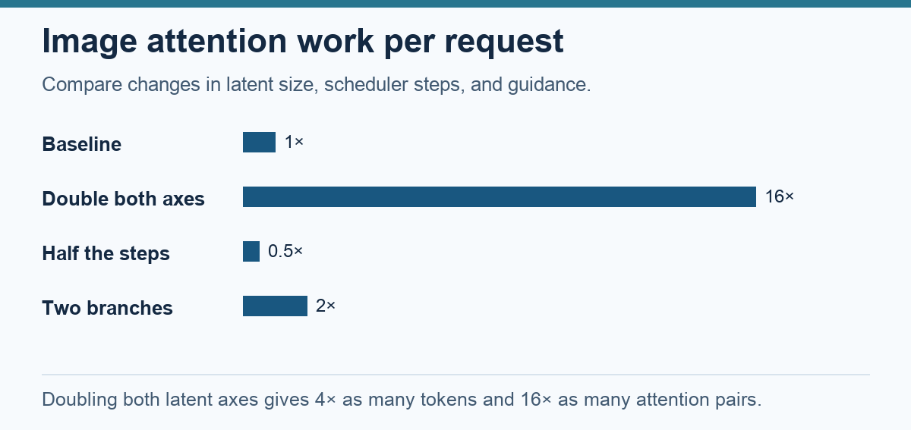

# Lab 1.14 · Image generation inference bottlenecks

**Time** 15–20 minutes · **Hardware** CPU · **Software** Python 3 and Jupyter

Why can image generation spend so much time in attention even with a smaller model?

Kiely contrasts repeated denoising over a whole latent grid with single-token LLM decode. In a diffusion transformer, global self-attention can compare every spatial patch token with every other patch token during each denoiser evaluation. At a fixed patch size, doubling both latent axes quadruples token count. Full attention then has sixteen times as many query-key pairs.

For a 16 × 16 latent with 2 × 2 patches, there are 64 tokens and 4,096 pairs per head. With head width d, the score product and weighted value product each cost about `2 × tokens² × d` FLOP per head. This exercise estimates those products alone. Softmax, projections, other layers, and memory traffic need separate accounting. The estimate explains why compute can dominate. Materializing large score matrices or changing the attention implementation can shift the actual bottleneck.

## Lab plan

| Exercise | What you will do | What to inspect |
| --- | --- | --- |
| 1. Count spatial attention work | Convert a latent grid into patch tokens and FLOP per block. | Compare doubling one axis with doubling both. |
| 2. Scale to a denoising budget | Multiply by model evaluations and attention blocks. | Compare changing resolution with changing steps or guidance. |

## Run the lab

Follow the [local setup](../../../README.md#run-the-notebooks-locally), then open [lab.ipynb](lab.ipynb). Run the setup, make the predictions, then complete each TODO and run its check. The notebook uses only the standard library and includes all inputs.

| Time | Activity |
| --- | --- |
| 3 min | Read the setup and predict the first result. |
| 6 min | Complete and check the first implementation. |
| 6 min | Complete the second exercise and inspect the results. |
| 2–4 min | Explain what changed using the wrap-up questions. |

Reading companion for Section 2.4.3, p. 67 of *Inference Engineering* by Philip Kiely (Baseten Books).

[Back to the learning roadmap](../../../README.md#learning-roadmap)
