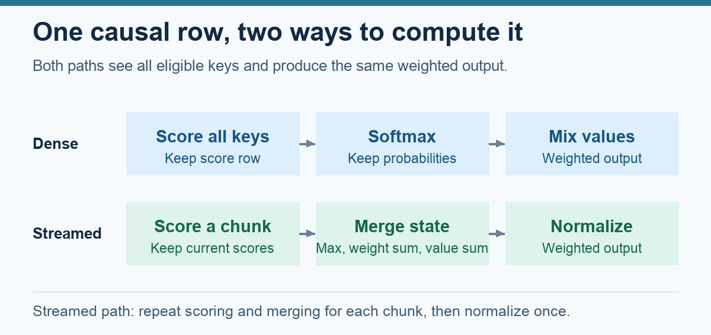

# Lab 1.15 · Optimizing attention

**Time** 15–20 minutes · **Hardware** CPU · **Software** Python 3 and Jupyter

Why can exact attention use less temporary memory without changing which tokens it can read?

Kiely explains that a straightforward implementation writes the score matrix and the softmax probability matrix, only to read them again in the next operation. **FlashAttention** tiles and fuses the calculation to avoid materializing those full matrices in GPU memory. It still covers the same query–key pairs. **PagedAttention** addresses a different problem by organizing the persistent KV cache into pages. **Sliding-window attention** instead changes which keys each query can see.

In this lab, the reference keeps scores and probabilities for every causal row. You will stream one query at a time over key chunks. For each chunk, track the running maximum score, the sum of exponentials relative to that maximum, and the weighted sum of values on the same scale. Divide the weighted sum by the normalizer after the last chunk. For example, if the running max rises from 2 to 3, multiply both old sums by exp(2 − 3) before adding the new contribution. That rescaling keeps early and late contributions comparable.

For N causal queries the two reference intermediates together contain N(N+1) scalar entries. With chunks of size B, the streamed loop holds at most B scores at once and keeps an accumulator of value width. These are counts for the intermediates shown here. They exclude inputs, outputs and Python overhead and do not measure GPU traffic or speed.

## Lab plan

| Exercise | What you will do | What to inspect |
| --- | --- | --- |
| 1. Merge a chunk | Rebase the existing sums when a higher score appears. | Test large absolute scores and a maximum change and signed, two-component values. |
| 2. Stream causal attention | Process only eligible keys in chunks and normalize once per query. | Match the dense output with different chunk sizes. Then restrict visibility and inspect the change. |

## Apply it to an inference system

At fixed head and value widths, streaming keeps the full causal pair count at O(N²) and reduces the temporary score storage in this implementation. A window of width w permits at most Nw pairs and changes the set of visible keys. To compare GPU kernels, report measured time and DRAM traffic at matching shapes, masks, and precision.

**Validating an optimized attention kernel.** Use the dense implementation as a numerical oracle. Name two inputs besides the seeded case you would use to test an optimized version. Include a case that changes the running maximum across chunks and a case with a partial final chunk. Separately specify what you would measure to support a memory-traffic claim.

## Run the lab

Follow the [local setup](../../../README.md#run-the-notebooks-locally), then open [lab.ipynb](lab.ipynb). Run the setup, make the predictions, then complete each TODO and run its check. The notebook uses only the standard library and includes all inputs.

| Time | Activity |
| --- | --- |
| 3 min | Read the setup and predict the first result. |
| 6 min | Complete and check the first implementation. |
| 6 min | Complete the second exercise and inspect the results. |
| 2–4 min | Explain what changed using the wrap-up questions. |

Reading companion for Section 2.5, pp. 67–69 of *Inference Engineering* by Philip Kiely (Baseten Books).

[Back to the learning roadmap](../../../README.md#learning-roadmap)
